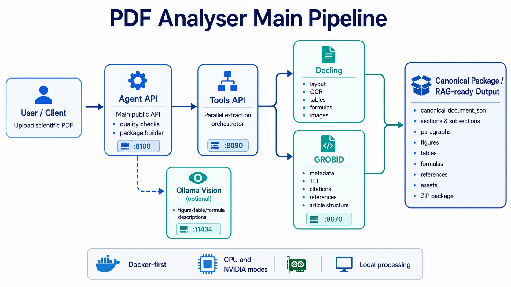
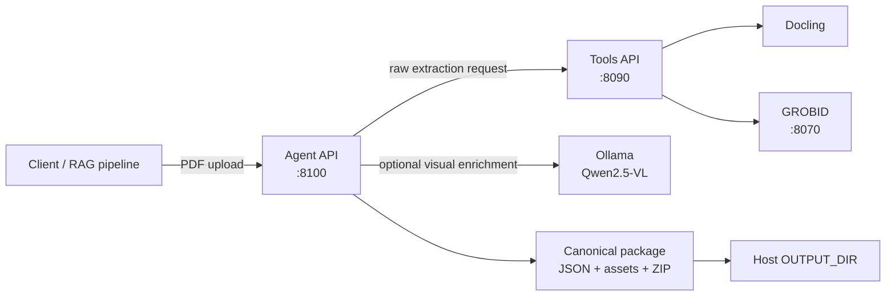

# PDF Analyser v0.3.0



A Docker-first scientific PDF understanding stack:

```text
PDF
  -> Docling + GROBID extraction
  -> hierarchical sections/subsections
  -> canonical JSON and exported assets
  -> optional Ollama vision descriptions for figures, tables, and formulas
```

The root Compose stack starts all services on one private Docker network:

```text
grobid -> extractor-api -> agent-api
                    \-> ollama
```

The Agent writes complete packages into a host directory selected in `.env`.

## Fastest installation

### Linux or macOS, CPU mode

```bash
unzip pdf-analyser-v0.3.0.zip
cd pdf-analyser
./scripts/install.sh
```

### Windows PowerShell, CPU mode

```powershell
Expand-Archive .\pdf-analyser-v0.3.0.zip
cd .\pdf-analyser
.\scripts\install.ps1
```

### Linux with an NVIDIA GPU

Docker must already be able to run:

```bash
docker run --rm --gpus all ubuntu nvidia-smi
```

Then:

```bash
./scripts/install-nvidia.sh
```

The first startup is slower because Docker builds the two application images and downloads Docling, GROBID, and the configured Ollama model.

## Manual installation

Copy the example configuration:

```bash
cp .env.example .env
```

Edit `.env`, then start CPU mode:

```bash
docker compose -f compose.yaml up -d --build
```

Start NVIDIA mode:

```bash
docker compose \
  -f compose.yaml \
  -f compose.nvidia.yaml \
  up -d --build
```

Check the stack:

```bash
docker compose -f compose.yaml ps
```

Check runtime readiness:

```bash
curl -sS http://localhost:8090/health/ready | jq
curl -sS http://localhost:8100/health/ready | jq
curl -sS http://localhost:8100/v1/runtime | jq
```

Expected local endpoints:

| Service | URL |
|---|---|
| Tools API | `http://localhost:8090` |
| Tools Swagger | `http://localhost:8090/docs` |
| Agent API | `http://localhost:8100` |
| Agent Swagger | `http://localhost:8100/docs` |
| GROBID | `http://localhost:8086` |

Ollama is intentionally available only to the other containers and is not published on a host port.

## Choose the host output directory

Set `OUTPUT_DIR` in the root `.env` file:

```dotenv
OUTPUT_DIR=./outputs
```

Examples:

```dotenv
# Linux
OUTPUT_DIR=/srv/pdf-results

# macOS
OUTPUT_DIR=/Users/amir/pdf-results

# Windows Docker Desktop
OUTPUT_DIR=C:/Users/amir/pdf-results
```

The selected host path is bind-mounted into the Agent as `/data/outputs`.

## Choose a folder name for each PDF

The `output_folder` multipart field creates a named directory below `OUTPUT_DIR`.

```bash
curl \
  --fail \
  --show-error \
  -X POST \
  "http://localhost:8100/v1/process" \
  -F "file=@/absolute/path/VRX.pdf;type=application/pdf" \
  -F "use_llm=true" \
  -F "output_folder=VRX_case_001" \
  -F "overwrite=false" \
  -o agent-result.json
```

With:

```dotenv
OUTPUT_DIR=/srv/pdf-results
```

the result is written to:

```text
/srv/pdf-results/
├── VRX_case_001/
│   ├── canonical_document.json
│   ├── source/
│   ├── text/
│   ├── figures/
│   ├── tables/
│   ├── formulas/
│   └── latex/
└── VRX_case_001.zip
```

`output_folder` is a name, not a path. The API rejects path separators and traversal values such as `../outside`. Spaces are normalized to underscores. Names are limited to 100 characters, and Windows-reserved names such as `CON` and `LPT1` are rejected.

If the target already exists, the API returns HTTP `409` unless the request explicitly sends:

```bash
-F "overwrite=true"
```

When `output_folder` is omitted, the SHA-256 document ID remains the default folder name for backward compatibility.

## Output response

The response includes both the document identity and the chosen package folder:

```json
{
  "document_id": "f8a9...",
  "package_name": "VRX_case_001",
  "output_folder": "VRX_case_001",
  "package_directory": "/data/outputs/VRX_case_001",
  "canonical_json": "/data/outputs/VRX_case_001/canonical_document.json",
  "zip_file": "/data/outputs/VRX_case_001.zip"
}
```

The canonical JSON also records:

```json
{
  "output": {
    "folder_name": "VRX_case_001",
    "relative_path": "VRX_case_001",
    "zip_name": "VRX_case_001.zip"
  }
}
```

## Ollama model

The default model is:

```dotenv
OLLAMA_MODEL=qwen2.5vl:3b
```

The one-shot `ollama-model-init` service automatically pulls it into the persistent `ollama-models` Docker volume. Change `OLLAMA_MODEL` in `.env` and run:

```bash
make pull-model
```

or recreate the stack:

```bash
docker compose -f compose.yaml up -d
```

## Common commands

```bash
make init
make up-cpu
make up-gpu
make ready
make logs
make down
```

Process a PDF with a custom output folder:

```bash
make process \
  PDF=/absolute/path/VRX.pdf \
  USE_LLM=true \
  OUTPUT_FOLDER=VRX_case_001
```

Replace an existing package deliberately:

```bash
make process \
  PDF=/absolute/path/VRX.pdf \
  USE_LLM=true \
  OUTPUT_FOLDER=VRX_case_001 \
  OVERWRITE=true
```

## Portability

CPU mode is the portable deployment target for Docker Engine or Docker Desktop. The current release should be treated as an `linux/amd64` reference until the complete stack has also been integration-tested on ARM64 hardware. Windows and macOS users run the same Linux containers through Docker Desktop.

GPU mode is an optional acceleration layer:

- NVIDIA Linux/Windows hosts require a compatible NVIDIA driver and NVIDIA Container Toolkit;
- Docker Desktop GPU passthrough depends on the host platform;
- CPU mode remains available when GPU passthrough is unavailable, although extraction and vision inference are slower.

For a public binary-style release, publish the application images to GHCR or Docker Hub and replace the local `build:` sections with versioned `image:` references. The included source-build Compose file works without Python, Java, Docling, GROBID, or Ollama installed directly on the host; the host needs Docker Compose, internet access for the initial image/model downloads, and enough CPU/RAM/storage for the selected model.

## Security

The default `.env.example` binds APIs to `127.0.0.1` only. Do not change the bind host to `0.0.0.0` on an untrusted network without adding authentication, TLS, request-rate limits, and an upload policy.

## Development and validation

```bash
make test
make lint
make check
```

The package includes unit tests for:

- hierarchical sections and subsections;
- paragraph and visual-element section links;
- figure/table/formula LLM descriptions;
- safe custom output folder names;
- overwrite collision protection;
- GROBID liveness content negotiation.
# PDF Analyser

<p align="center">
  <strong>Docker-first scientific PDF understanding with Docling, GROBID, FastAPI, and optional Ollama vision enrichment.</strong>
</p>

<p align="center">
  
  
  
  
</p>

PDF Analyser converts scientific articles into a **canonical, RAG-ready document package** containing structured metadata, hierarchical sections and subsections, paragraphs, references, figures, tables, formulas, text exports, LaTeX exports, provenance, and quality information.

The pipeline combines:

* **Docling** for document layout, reading order, OCR, tables, formulas, and image assets;
* **GROBID** for scholarly metadata, TEI XML, citations, references, and article structure;
* a deterministic **Agent API** that merges both outputs into one canonical schema;
* optional **Ollama vision enrichment** for descriptions of figures, tables, and formulas.

> The LLM is an optional enrichment layer. Parser evidence is retained and is never silently replaced by model-generated content.

---

## Table of contents

* [Features](#features)
* [Architecture](#architecture)
* [What the pipeline produces](#what-the-pipeline-produces)
* [Requirements and platform support](#requirements-and-platform-support)
* [Quick start](#quick-start)
* [Configuration](#configuration)
* [Using the API](#using-the-api)
* [Agent API reference](#agent-api-reference)
* [Tools API reference](#tools-api-reference)
* [Output package](#output-package)
* [Canonical JSON](#canonical-json)
* [LLM enrichment](#llm-enrichment)
* [Common operations](#common-operations)
* [Troubleshooting](#troubleshooting)
* [Security and production deployment](#security-and-production-deployment)
* [Development](#development)
* [Repository layout](#repository-layout)

---

## Features

* **Dual extraction pipeline** — runs Docling and GROBID in parallel.
* **Scientific article structure** — preserves sections, subsections, parent/child relationships, section levels, and full section paths.
* **Canonical paragraphs** — links paragraphs and Docling text blocks to article sections.
* **Rich visual assets** — exports figures, tables, and formula crops.
* **Multiple table formats** — CSV, Markdown, HTML, and LaTeX.
* **Formula exports** — image, text, and LaTeX when available.
* **Optional vision descriptions** — uses an Ollama vision model to describe every available figure, table, and formula image.
* **Bounded repair** — can assist with empty tables and uncertain formulas while retaining the original parser output.
* **Quality report** — records quality status, warnings, counts, and provenance in the canonical JSON.
* **Configurable output root** — choose the host output directory in `.env`.
* **Custom package names** — choose a safe output folder for every request.
* **CPU and NVIDIA modes** — one Compose stack with an optional CUDA override.
* **Self-contained deployment** — no host Python, Java, Docling, GROBID, or Ollama installation is required.
* **Interactive API documentation** — Swagger UI and OpenAPI are provided by both FastAPI services.

---

## Architecture



The default root Compose stack runs all services on one private Docker network:

```text
Client
  |
  v
Agent API  --->  Ollama
  |
  v
Tools API  --->  Docling
  |
  v
GROBID
```

### Service responsibilities

| Service             | Responsibility                                                                                                                                                  |
| ------------------- | --------------------------------------------------------------------------------------------------------------------------------------------------------------- |
| `agent-api`         | Main public API; validates uploads, calls Tools, builds the canonical package, performs quality checks, optionally calls Ollama, and exposes package downloads. |
| `extractor-api`     | Lower-level extraction API; runs Docling and GROBID in parallel and returns raw, parsed, and merged extraction views.                                           |
| `grobid`            | Scholarly metadata, TEI XML, references, citations, and article structure.                                                                                      |
| `ollama`            | Optional local vision-model inference. The default model is `qwen2.5vl:3b`.                                                                                     |
| `ollama-model-init` | One-shot service that pulls the configured model into a persistent Docker volume. Exiting with code `0` is expected.                                            |

---

## What the pipeline produces

One PDF becomes one package:

```text
OUTPUT_DIR/
├── article_case_001/
│   ├── canonical_document.json
│   ├── source/
│   │   └── original.pdf
│   ├── text/
│   │   ├── full_text.txt
│   │   └── full_text.md
│   ├── figures/
│   │   ├── figure_001.png
│   │   ├── figure_001.caption.txt
│   │   ├── figure_001.description.txt      # when LLM enrichment succeeds
│   │   └── figure_001.description.json     # when LLM enrichment succeeds
│   ├── tables/
│   │   ├── table_001.png
│   │   ├── table_001.csv
│   │   ├── table_001.md
│   │   ├── table_001.html
│   │   ├── table_001.tex
│   │   ├── table_001.description.txt       # when LLM enrichment succeeds
│   │   └── table_001.description.json      # when LLM enrichment succeeds
│   ├── formulas/
│   │   ├── formula_001.png
│   │   ├── formula_001.txt
│   │   ├── formula_001.tex
│   │   ├── formula_001.description.txt     # when LLM enrichment succeeds
│   │   └── formula_001.description.json    # when LLM enrichment succeeds
│   └── latex/
│       ├── formulas.tex
│       ├── tables.tex
│       └── document_assets.tex
└── article_case_001.zip
```

The exact set of asset files depends on the content of the PDF and the quality of the extracted visual elements.

---

## Requirements and platform support

### Required

* Docker Engine + Docker Compose v2 on Linux, or Docker Desktop on Windows/macOS;
* internet access during the first build and model download;
* enough memory and storage for Docling, GROBID, Ollama, model files, build cache, and output packages.

### Practical recommendations

* **RAM:** 16 GB minimum recommended; 32 GB is preferable for large PDFs.
* **Free disk:** at least 30 GB; more may be required for Docker build cache and multiple model versions.
* **Concurrency:** keep `MAX_CONCURRENCY=1` initially because PDF extraction and vision inference are memory-intensive.

### Platform matrix

| Platform                       |    CPU mode | NVIDIA mode | Notes                                                                                          |
| ------------------------------ | ----------: | ----------: | ---------------------------------------------------------------------------------------------- |
| Linux x86-64                   |           ✅ |           ✅ | Primary deployment target. NVIDIA mode requires a working driver and NVIDIA Container Toolkit. |
| Windows 10/11 + Docker Desktop |           ✅ |           ✅ | NVIDIA mode requires the WSL 2 backend and working Docker GPU passthrough.                     |
| Intel macOS + Docker Desktop   |           ✅ |           ❌ | Use CPU mode.                                                                                  |
| Apple Silicon macOS            | Best effort |           ❌ | The current release has not been fully integration-tested on ARM64.                            |
| AMD/Intel GPU                  |           ✅ |           ❌ | The included GPU override is NVIDIA/CUDA only; use CPU mode.                                   |

---

## Quick start

### 1. Download or clone

Release archive:

```bash
unzip pdf-analyser-v0.3.0.zip
cd pdf-analyser
```

Git:

```bash
git clone <YOUR_REPOSITORY_URL>.git pdf-analyser
cd pdf-analyser
```

### 2. Create the configuration

```bash
cp .env.example .env
```

Choose an output directory in `.env`:

```dotenv
# Relative to the repository root
OUTPUT_DIR=./outputs

# Linux example
# OUTPUT_DIR=/srv/pdf-results

# macOS example
# OUTPUT_DIR=/Users/yourname/pdf-results

# Windows Docker Desktop example
# OUTPUT_DIR=C:/Users/YourName/pdf-results
```

### 3. Start the stack

#### Linux or macOS — CPU

```bash
./scripts/install.sh
```

#### Linux — NVIDIA GPU

First verify Docker GPU access:

```bash
docker run --rm --gpus all ubuntu nvidia-smi
```

Then start:

```bash
./scripts/install-nvidia.sh
```

#### Windows PowerShell — CPU

```powershell
Copy-Item .env.example .env
.\scripts\install.ps1
```

If PowerShell blocks the script:

```powershell
Set-ExecutionPolicy -Scope Process Bypass
.\scripts\install.ps1
```

#### Windows PowerShell — NVIDIA GPU

Verify Docker GPU access:

```powershell
docker run --rm --gpus all ubuntu nvidia-smi
```

Start with the NVIDIA Compose override:

```powershell
docker compose `
  -f compose.yaml `
  -f compose.nvidia.yaml `
  up -d --build
```

### 4. Monitor the first startup

The first startup is slower because Docker builds the application images and downloads Docling assets and the configured Ollama model.

CPU:

```bash
docker compose -f compose.yaml ps
docker compose -f compose.yaml logs -f --tail=100
```

NVIDIA:

```bash
docker compose \
  -f compose.yaml \
  -f compose.nvidia.yaml \
  ps
```

### 5. Verify readiness

```bash
curl -sS http://localhost:8090/health/ready | jq
curl -sS http://localhost:8100/health/ready | jq
curl -sS http://localhost:8100/v1/runtime | jq
```

Expected Tools readiness:

```json
{
  "status": "ready",
  "grobid": true,
  "docling": true
}
```

Expected Agent readiness includes:

```json
{
  "status": "ready",
  "tools_ready": true,
  "llm_enabled": true,
  "llm_alive": true,
  "ready": true
}
```

The Agent can still be ready when the optional LLM is unavailable, because deterministic extraction remains usable. In that case, LLM descriptions are skipped and a warning is recorded.

### Local service URLs

| Service            | URL                                  |
| ------------------ | ------------------------------------ |
| Agent API          | `http://localhost:8100`              |
| Agent Swagger UI   | `http://localhost:8100/docs`         |
| Agent OpenAPI JSON | `http://localhost:8100/openapi.json` |
| Tools API          | `http://localhost:8090`              |
| Tools Swagger UI   | `http://localhost:8090/docs`         |
| Tools OpenAPI JSON | `http://localhost:8090/openapi.json` |
| GROBID             | `http://localhost:8086`              |

Ollama is intentionally kept inside the Docker network and is not published to a host port by default.

---

## Configuration

Edit the root `.env` file, then recreate the stack.

### Most important settings

| Variable                           | Default        | Description                                                                                 |
| ---------------------------------- | -------------- | ------------------------------------------------------------------------------------------- |
| `OUTPUT_DIR`                       | `./outputs`    | Host directory where canonical packages and ZIP files are written.                          |
| `TOOLS_PORT`                       | `8090`         | Host port for the Tools API.                                                                |
| `AGENT_PORT`                       | `8100`         | Host port for the Agent API.                                                                |
| `GROBID_PORT`                      | `8086`         | Host port for the GROBID API.                                                               |
| `MAX_UPLOAD_SIZE_MB`               | `100`          | Maximum PDF upload size.                                                                    |
| `MAX_CONCURRENCY`                  | `1`            | Maximum concurrent Agent jobs.                                                              |
| `DOCLING_MAX_NUM_PAGES`            | `300`          | Maximum pages accepted by Docling.                                                          |
| `DOCLING_DOCUMENT_TIMEOUT_SECONDS` | `1800`         | Docling processing timeout.                                                                 |
| `LLM_ENABLED`                      | `true`         | Enables Ollama integration at the service level.                                            |
| `LLM_DESCRIBE_ALL_ELEMENTS`        | `true`         | Generates descriptions for available figure, table, and formula images when `use_llm=true`. |
| `LLM_MAX_ITEMS_PER_DOCUMENT`       | `500`          | Maximum LLM visual items processed per PDF.                                                 |
| `OLLAMA_MODEL`                     | `qwen2.5vl:3b` | Vision model pulled and used by Ollama.                                                     |
| `OLLAMA_TIMEOUT_SECONDS`           | `600`          | Per-request Ollama timeout.                                                                 |
| `CREATE_ZIP_PACKAGE`               | `true`         | Creates a ZIP archive beside each output folder.                                            |
| `OVERWRITE_EXISTING_PACKAGE`       | `false`        | Global default when a request does not explicitly send `overwrite`.                         |
| `KEEP_RAW_EXTRACTOR_RESPONSE`      | `false`        | Saves the complete Tools response under `source/` for debugging/evaluation.                 |

<details>
<summary><strong>Complete root environment reference</strong></summary>

### Project and ports

| Variable               | Default        | Description                                                                     |
| ---------------------- | -------------- | ------------------------------------------------------------------------------- |
| `COMPOSE_PROJECT_NAME` | `pdf-analyser` | Docker Compose project name.                                                    |
| `APP_VERSION`          | `0.3.0`        | Application release version.                                                    |
| `TOOLS_BIND_HOST`      | `127.0.0.1`    | Host interface for Tools. Keep local-only unless a reverse proxy is configured. |
| `TOOLS_PORT`           | `8090`         | Tools host port.                                                                |
| `AGENT_BIND_HOST`      | `127.0.0.1`    | Host interface for Agent.                                                       |
| `AGENT_PORT`           | `8100`         | Agent host port.                                                                |
| `GROBID_BIND_HOST`     | `127.0.0.1`    | Host interface for GROBID.                                                      |
| `GROBID_PORT`          | `8086`         | GROBID API host port.                                                           |
| `GROBID_ADMIN_PORT`    | `8085`         | GROBID admin host port.                                                         |

### Output and ownership

| Variable                      | Default     | Description                                                                 |
| ----------------------------- | ----------- | --------------------------------------------------------------------------- |
| `OUTPUT_DIR`                  | `./outputs` | Host output root. Relative paths resolve from the repository root.          |
| `HOST_UID`                    | `1000`      | Linux owner UID for generated files. `install.sh` updates it automatically. |
| `HOST_GID`                    | `1000`      | Linux owner GID for generated files. `install.sh` updates it automatically. |
| `KEEP_RAW_EXTRACTOR_RESPONSE` | `false`     | Retains raw extractor response in each package.                             |
| `OVERWRITE_EXISTING_PACKAGE`  | `false`     | Global overwrite default.                                                   |
| `CREATE_ZIP_PACKAGE`          | `true`      | Creates `<package>.zip`.                                                    |

### Uploads and workers

| Variable             | Default | Description            |
| -------------------- | ------- | ---------------------- |
| `MAX_UPLOAD_SIZE_MB` | `100`   | Upload-size limit.     |
| `MAX_CONCURRENCY`    | `1`     | Agent job concurrency. |
| `LOG_LEVEL`          | `INFO`  | Application log level. |

### Docling and GROBID

| Variable                           | Default | Description                             |
| ---------------------------------- | ------- | --------------------------------------- |
| `DOCLING_MAX_NUM_PAGES`            | `300`   | Maximum PDF pages.                      |
| `DOCLING_MAX_CONCURRENCY`          | `1`     | Concurrent Docling conversions.         |
| `DOCLING_DOCUMENT_TIMEOUT_SECONDS` | `1800`  | Per-document timeout.                   |
| `DOCLING_ACCELERATOR_NUM_THREADS`  | `4`     | CPU worker threads.                     |
| `DOCLING_PRELOAD_ON_STARTUP`       | `true`  | Initializes Docling during API startup. |
| `GROBID_TIMEOUT_SECONDS`           | `300`   | GROBID request timeout.                 |
| `GROBID_MAX_RETRIES`               | `2`     | GROBID retry count.                     |

### Ollama / LLM

| Variable                     | Default        | Description                                                                         |
| ---------------------------- | -------------- | ----------------------------------------------------------------------------------- |
| `LLM_ENABLED`                | `true`         | Enables the LLM client.                                                             |
| `LLM_DESCRIBE_ALL_ELEMENTS`  | `true`         | Describes every available figure/table/formula image for jobs that request LLM use. |
| `LLM_MAX_ITEMS_PER_DOCUMENT` | `500`          | Per-document LLM item budget.                                                       |
| `OLLAMA_MODEL`               | `qwen2.5vl:3b` | Model tag.                                                                          |
| `OLLAMA_TIMEOUT_SECONDS`     | `600`          | Request timeout.                                                                    |
| `OLLAMA_SERVER_KEEP_ALIVE`   | `0`            | Ollama server model-retention setting. `0` unloads immediately.                     |
| `OLLAMA_REQUEST_KEEP_ALIVE`  | `0`            | Keep-alive sent with inference requests.                                            |
| `OLLAMA_TEMPERATURE`         | `0.0`          | Sampling temperature.                                                               |

### Quality

| Variable                   | Default | Description                                             |
| -------------------------- | ------- | ------------------------------------------------------- |
| `QUALITY_GREEN_THRESHOLD`  | `0.90`  | Minimum score for green quality.                        |
| `QUALITY_YELLOW_THRESHOLD` | `0.65`  | Minimum score for yellow quality. Lower scores are red. |

</details>

### Apply configuration changes

CPU:

```bash
docker compose \
  -f compose.yaml \
  up -d --build --force-recreate --remove-orphans
```

NVIDIA:

```bash
docker compose \
  -f compose.yaml \
  -f compose.nvidia.yaml \
  up -d --build --force-recreate --remove-orphans
```

### Change the Ollama model

Edit:

```dotenv
OLLAMA_MODEL=qwen2.5vl:7b
```

Then pull it:

```bash
make pull-model
```

or:

```bash
docker compose -f compose.yaml run --rm ollama-model-init
```

The 7B model may improve descriptions but requires substantially more memory than the default 3B model.

---

## Using the API

The **Agent API** is the recommended application interface. It calls the Tools API internally and produces the final canonical package.

### Process a PDF — Linux/macOS

```bash
curl \
  --fail \
  --show-error \
  -X POST \
  "http://localhost:8100/v1/process" \
  -F "file=@/absolute/path/article.pdf;type=application/pdf" \
  -F "use_llm=true" \
  -F "output_folder=article_case_001" \
  -F "overwrite=false" \
  -o agent-result.json

jq . agent-result.json
```

### Process a PDF — Windows PowerShell

Use `curl.exe`, not PowerShell's `curl` alias:

```powershell
curl.exe `
  --fail `
  --show-error `
  -X POST `
  "http://localhost:8100/v1/process" `
  -F "file=@C:/Users/YourName/Documents/article.pdf;type=application/pdf" `
  -F "use_llm=true" `
  -F "output_folder=article_case_001" `
  -F "overwrite=false" `
  -o agent-result.json

Get-Content .\agent-result.json | ConvertFrom-Json
```

### Process with Make

```bash
make process \
  PDF=/absolute/path/article.pdf \
  USE_LLM=true \
  OUTPUT_FOLDER=article_case_001 \
  OVERWRITE=false
```

---

## Agent API reference

Base URL:

```text
http://localhost:8100
```

Interactive documentation:

```text
http://localhost:8100/docs
```

### Endpoints

| Method | Path                                   | Description                                                                                |
| ------ | -------------------------------------- | ------------------------------------------------------------------------------------------ |
| `GET`  | `/health/live`                         | Process liveness. Returns `200` when the FastAPI process is running.                       |
| `GET`  | `/health/ready`                        | Dependency readiness. Tools must be ready; LLM status is reported separately.              |
| `GET`  | `/v1/runtime`                          | Application version, Tools readiness, LLM configuration/status, and container output path. |
| `POST` | `/v1/process`                          | Process a PDF and create a canonical package.                                              |
| `GET`  | `/v1/packages/{package_name}`          | Download `canonical_document.json` by custom package name.                                 |
| `GET`  | `/v1/packages/{package_name}/download` | Download the ZIP by custom package name.                                                   |
| `GET`  | `/v1/documents/{document_id}`          | Download canonical JSON for a SHA-256-named package.                                       |
| `GET`  | `/v1/documents/{document_id}/download` | Download ZIP for a SHA-256-named package.                                                  |
| `GET`  | `/packages/{package_name}/...`         | Static access to package files and exported assets.                                        |

### `POST /v1/process`

Content type:

```text
multipart/form-data
```

#### Form fields

| Field           | Type     | Required | Default                      | Description                                                                            |
| --------------- | -------- | -------: | ---------------------------- | -------------------------------------------------------------------------------------- |
| `file`          | PDF file |      Yes | —                            | Scientific article PDF. Non-PDF extensions are rejected.                               |
| `use_llm`       | boolean  |       No | `false`                      | Requests LLM enrichment for this document. `LLM_ENABLED=true` must also be configured. |
| `output_folder` | string   |       No | PDF SHA-256                  | Safe child-folder/package name under `OUTPUT_DIR`. This is a name, not a path.         |
| `overwrite`     | boolean  |       No | `OVERWRITE_EXISTING_PACKAGE` | Replaces an existing package with the same output name when `true`.                    |

#### Output-folder rules

Accepted:

```text
article_case_001
paper-2026-07
study.version.2
```

Spaces are normalized to underscores.

Rejected:

```text
../outside
nested/folder
nested\folder
CON
LPT1
```

The API does not accept an arbitrary output path. This prevents callers from writing outside the administrator-selected `OUTPUT_DIR`.

#### Example response

```json
{
  "schema_version": "0.3.0",
  "status": "completed_with_warnings",
  "document_id": "f8a9c2...",
  "package_name": "article_case_001",
  "output_folder": "article_case_001",
  "package_directory": "/data/outputs/article_case_001",
  "canonical_json": "/data/outputs/article_case_001/canonical_document.json",
  "zip_file": "/data/outputs/article_case_001.zip",
  "urls": {
    "assets_base": "/packages/article_case_001/",
    "canonical_json": "/packages/article_case_001/canonical_document.json",
    "zip": "/packages/article_case_001.zip",
    "download": "/v1/packages/article_case_001/download"
  },
  "quality": {
    "status": "yellow",
    "score": 0.84
  },
  "counts": {
    "text_blocks": 153,
    "paragraphs": 81,
    "sections": 14,
    "root_sections": 6,
    "figures": 4,
    "tables": 3,
    "formulas": 12,
    "references": 52
  },
  "warnings": [],
  "processing": {
    "total_duration_seconds": 121.7
  }
}
```

`completed_with_warnings` does not necessarily mean the job failed. It means the package was produced but the quality report or extraction pipeline recorded one or more issues that should be reviewed.

#### Common HTTP responses

| Status | Meaning                                                               |
| -----: | --------------------------------------------------------------------- |
|  `200` | Package created successfully.                                         |
|  `400` | Invalid request value or processing validation error.                 |
|  `409` | Target output package already exists and overwrite is disabled.       |
|  `415` | Uploaded file is not a PDF.                                           |
|  `422` | Invalid `output_folder` or malformed form data.                       |
|  `502` | Upstream extraction or package processing failed.                     |
|  `503` | Readiness endpoint reports that a required dependency is unavailable. |

### Download a package

Canonical JSON:

```bash
curl \
  --fail \
  "http://localhost:8100/v1/packages/article_case_001" \
  -o canonical_document.json
```

ZIP:

```bash
curl \
  --fail \
  "http://localhost:8100/v1/packages/article_case_001/download" \
  -o article_case_001.zip
```

Static asset example:

```bash
curl \
  --fail \
  "http://localhost:8100/packages/article_case_001/figures/figure_001.png" \
  -o figure_001.png
```

---

## Tools API reference

The Tools API is the lower-level extraction interface. Use it when you need raw Docling/GROBID output, direct extractor diagnostics, or custom extraction options. Most applications should call the Agent API instead.

Base URL:

```text
http://localhost:8090
```

Interactive documentation:

```text
http://localhost:8090/docs
```

### Endpoints

| Method | Path                            | Description                                                   |
| ------ | ------------------------------- | ------------------------------------------------------------- |
| `GET`  | `/health/live`                  | Tools API process liveness.                                   |
| `GET`  | `/health/ready`                 | Reports Docling initialization and GROBID liveness.           |
| `GET`  | `/v1/runtime`                   | Docling runtime/device information and GROBID status/version. |
| `POST` | `/v1/extract`                   | Run Docling and GROBID extraction in parallel.                |
| `GET`  | `/assets/{document_sha256}/...` | Access exported Docling figure/table assets.                  |

### `POST /v1/extract`

Content type:

```text
multipart/form-data
```

#### Form fields

| Field                             | Type     | Default            | Description                                                  |
| --------------------------------- | -------- | ------------------ | ------------------------------------------------------------ |
| `file`                            | PDF file | required           | Scientific article PDF.                                      |
| `include_docling_markdown`        | boolean  | `true`             | Include Docling Markdown output.                             |
| `include_docling_json`            | boolean  | `true`             | Include Docling document JSON.                               |
| `include_grobid_tei`              | boolean  | `true`             | Include raw GROBID TEI XML.                                  |
| `export_picture_images`           | boolean  | configured default | Persist figure/picture images.                               |
| `export_table_images`             | boolean  | configured default | Persist table images.                                        |
| `grobid_consolidate_header`       | string   | `"0"`              | GROBID header consolidation mode, accepted values `0`–`3`.   |
| `grobid_consolidate_citations`    | string   | `"0"`              | GROBID citation consolidation mode, accepted values `0`–`2`. |
| `grobid_include_raw_citations`    | boolean  | `true`             | Include raw citation strings.                                |
| `grobid_include_raw_affiliations` | boolean  | `true`             | Include raw affiliation strings.                             |
| `grobid_segment_sentences`        | boolean  | `true`             | Request sentence segmentation in TEI output.                 |

#### Example

```bash
curl \
  --fail \
  --show-error \
  -X POST \
  "http://localhost:8090/v1/extract" \
  -F "file=@/absolute/path/article.pdf;type=application/pdf" \
  -F "include_docling_markdown=true" \
  -F "include_docling_json=true" \
  -F "include_grobid_tei=true" \
  -F "export_picture_images=true" \
  -F "export_table_images=true" \
  -o extraction.json

jq . extraction.json
```

The response contains:

```json
{
  "schema_version": "0.2.0",
  "request_id": "...",
  "status": "completed",
  "document": {
    "filename": "article.pdf",
    "size_bytes": 1234567,
    "sha256": "...",
    "asset_namespace": "..."
  },
  "options": {},
  "processing": {
    "parallel_extractors": true
  },
  "docling": {
    "status": "completed",
    "version": "...",
    "stats": {},
    "raw": {},
    "parsed": {}
  },
  "grobid": {
    "status": "completed",
    "version": "...",
    "stats": {},
    "raw": {},
    "parsed": {}
  },
  "merged": {},
  "warnings": []
}
```

If one parser fails and the other succeeds, the Tools response can be `partial`. If both fail, the API returns an upstream error.

---

## Output package

There are two independent output controls:

1. `OUTPUT_DIR` in `.env` selects the host parent directory.
2. `output_folder` in each `/v1/process` request selects the child package name.

Example:

```dotenv
OUTPUT_DIR=/srv/research-results
```

```bash
-F "output_folder=paper_2026_001"
```

Final host path:

```text
/srv/research-results/paper_2026_001/
```

The matching ZIP is:

```text
/srv/research-results/paper_2026_001.zip
```

When `output_folder` is omitted, the PDF SHA-256 document ID is used as the package name.

---

## Canonical JSON

`canonical_document.json` is the primary integration contract for downstream search, RAG, analytics, or knowledge-graph pipelines.

Top-level structure:

```json
{
  "schema_version": "1.2.0",
  "document_id": "<pdf-sha256>",
  "created_at": "2026-07-10T12:00:00+00:00",
  "output": {
    "folder_name": "article_case_001",
    "relative_path": "article_case_001",
    "zip_name": "article_case_001.zip"
  },
  "document": {
    "filename": "article.pdf",
    "sha256": "<pdf-sha256>",
    "size_bytes": 1234567,
    "source_pdf": "source/original.pdf"
  },
  "metadata": {},
  "content": {
    "full_text": "...",
    "text_blocks": [],
    "paragraphs": [],
    "sections": [],
    "section_tree": [],
    "figures": [],
    "tables": [],
    "formulas": [],
    "references": []
  },
  "assets": {},
  "provenance": {},
  "warnings": [],
  "quality": {},
  "counts": {}
}
```

### Hierarchical sections

A subsection retains its relationship to its parent:

```json
{
  "id": "sec_002",
  "title": "Dataset",
  "number": "2.1",
  "level": 2,
  "parent_id": "sec_001",
  "path": [
    "Methods",
    "Dataset"
  ],
  "child_section_ids": [],
  "paragraph_ids": [
    "para_00012",
    "para_00013"
  ],
  "figure_ids": [
    "figure_001"
  ],
  "table_ids": [
    "table_001"
  ],
  "formula_ids": []
}
```

### Paragraph-to-section links

```json
{
  "id": "para_00012",
  "section_id": "sec_002",
  "section_path": [
    "Methods",
    "Dataset"
  ],
  "order": 12,
  "text": "The training dataset contains ...",
  "page_start": 4,
  "page_end": 4
}
```

### Asset-to-section links

Figures, tables, and formulas contain section context where the relationship can be resolved:

```json
{
  "id": "table_001",
  "caption": "Performance on the validation set",
  "section_id": "sec_006",
  "section_title": "Performance Evaluation",
  "section_path": [
    "Results",
    "Performance Evaluation"
  ],
  "section_assignment": {
    "method": "grobid_tei_element_id",
    "confidence": 1.0
  }
}
```

This context is useful for RAG because an extracted table or formula can be indexed together with its article title and section path.

---

## LLM enrichment

LLM enrichment requires both service-level and request-level enablement.

In `.env`:

```dotenv
LLM_ENABLED=true
LLM_DESCRIBE_ALL_ELEMENTS=true
OLLAMA_MODEL=qwen2.5vl:3b
```

In the request:

```bash
-F "use_llm=true"
```

When an image asset is available, the Agent can add a description object to figures, tables, and formulas:

```json
{
  "description": {
    "text": "The figure shows an encoder-decoder architecture with two connected processing paths.",
    "summary": "Encoder-decoder architecture diagram.",
    "element_type": "figure",
    "source": "ollama_vision",
    "model": "qwen2.5vl:3b",
    "confidence": 0.91,
    "warnings": []
  }
}
```

Important behavior:

* `use_llm=true` does not override `LLM_ENABLED=false`.
* The model must be installed and Ollama must be reachable.
* An element needs a usable image/crop before vision description can run.
* LLM output is marked with its source and model.
* Parser evidence remains in the canonical object.
* Failed or skipped LLM calls do not invalidate deterministic extraction.

Check LLM status:

```bash
curl -sS http://localhost:8100/v1/runtime | jq '.llm'
```

Expected:

```json
{
  "enabled": true,
  "provider": "ollama",
  "base_url": "http://ollama:11434",
  "model": "qwen2.5vl:3b",
  "alive": true
}
```

---

## Common operations

### Make targets

| Command                           | Description                                                      |
| --------------------------------- | ---------------------------------------------------------------- |
| `make init`                       | Create `.env` and the default output directory.                  |
| `make up-cpu`                     | Build and start the CPU stack.                                   |
| `make up-gpu`                     | Build and start the NVIDIA stack.                                |
| `make ready`                      | Check Tools readiness, Agent readiness, and runtime information. |
| `make process PDF=/path/file.pdf` | Process a PDF without LLM enrichment.                            |
| `make pull-model`                 | Pull the model configured by `OLLAMA_MODEL`.                     |
| `make logs`                       | Follow CPU-stack logs.                                           |
| `make logs-gpu`                   | Follow NVIDIA-stack logs.                                        |
| `make down`                       | Stop the CPU/default stack and remove orphans.                   |
| `make down-gpu`                   | Stop the NVIDIA stack and remove orphans.                        |
| `make test`                       | Run Tools and Agent tests.                                       |
| `make lint`                       | Run linters.                                                     |
| `make check`                      | Run formatting checks, lint, tests, and Python compilation.      |

### CPU lifecycle

```bash
# Start / update
docker compose -f compose.yaml up -d --build --remove-orphans

# Status
docker compose -f compose.yaml ps

# Logs
docker compose -f compose.yaml logs -f --tail=100

# Stop
docker compose -f compose.yaml down --remove-orphans
```

### NVIDIA lifecycle

```bash
# Start / update
docker compose \
  -f compose.yaml \
  -f compose.nvidia.yaml \
  up -d --build --remove-orphans

# Status
docker compose \
  -f compose.yaml \
  -f compose.nvidia.yaml \
  ps

# Logs
docker compose \
  -f compose.yaml \
  -f compose.nvidia.yaml \
  logs -f --tail=100

# Stop
docker compose \
  -f compose.yaml \
  -f compose.nvidia.yaml \
  down --remove-orphans
```

Stopping the stack does not delete the host `OUTPUT_DIR`, the Ollama model volume, or the Docling model cache.

To deliberately delete named model/cache volumes:

```bash
docker compose -f compose.yaml down -v --remove-orphans
```

---

## Troubleshooting

### An old `metadata-api` container appears as an orphan

This is harmless but should be cleaned up:

```bash
docker compose \
  -f compose.yaml \
  up -d --remove-orphans
```

NVIDIA:

```bash
docker compose \
  -f compose.yaml \
  -f compose.nvidia.yaml \
  up -d --remove-orphans
```

### `extractor-api` stays in `Waiting` or `health: starting`

Check status and logs:

```bash
docker compose -f compose.yaml ps -a

docker compose \
  -f compose.yaml \
  logs --tail=300 extractor-api
```

Check readiness directly:

```bash
curl -sS http://localhost:8090/health/ready | jq
curl -sS http://localhost:8090/v1/runtime | jq
```

The first startup may take longer because Docling initializes models and populates its cache.

### GROBID reports `Temporary failure in name resolution`

Ensure GROBID and the extractor were started from the same root Compose project:

```bash
docker compose \
  -f compose.yaml \
  down --remove-orphans

docker compose \
  -f compose.yaml \
  up -d
```

Test Docker DNS:

```bash
docker compose \
  -f compose.yaml \
  exec extractor-api \
  getent hosts grobid
```

Test GROBID from the extractor:

```bash
docker compose \
  -f compose.yaml \
  exec extractor-api \
  curl -sS http://grobid:8070/api/isalive
```

Expected:

```text
true
```

### Agent runtime shows `"llm": { "alive": false }`

Check Ollama and model initialization:

```bash
docker compose -f compose.yaml logs --tail=200 ollama

docker compose -f compose.yaml logs --tail=200 ollama-model-init

docker compose -f compose.yaml exec ollama ollama list
```

Test from the Agent container:

```bash
docker compose \
  -f compose.yaml \
  exec -T agent-api \
  python - <<'PY'
import httpx

response = httpx.get(
    "http://ollama:11434/api/tags",
    timeout=20.0,
)

print(response.status_code)
print(response.text)
PY
```

### All LLM descriptions are `null`

Verify:

```bash
curl -sS http://localhost:8100/v1/runtime | jq '.llm'
```

Confirm:

```text
LLM_ENABLED=true
LLM_DESCRIBE_ALL_ELEMENTS=true
use_llm=true
alive=true
```

Also inspect the process warnings and confirm the figure/table/formula has an image asset.

### Output folder already exists

Choose another folder:

```bash
-F "output_folder=article_case_002"
```

or deliberately replace it:

```bash
-F "overwrite=true"
```

### NVIDIA GPU is not detected

Verify Docker GPU access before starting the stack:

```bash
docker run --rm --gpus all ubuntu nvidia-smi
```

Then inspect the Tools runtime:

```bash
curl -sS http://localhost:8090/v1/runtime | jq '.docling'
```

Look for:

```json
{
  "configured_device": "cuda",
  "initialized": true,
  "cuda_available": true
}
```

### Docker Desktop on macOS fails with `commit snapshot ... input/output error`

This usually indicates Docker Desktop storage or BuildKit cache trouble rather than an application error.

Try:

1. Restart Docker Desktop.
2. Check free host disk space.
3. Increase Docker Desktop's disk allocation under **Settings → Resources → Advanced**.
4. Clear unused build cache:

```bash
docker builder prune --all --force
docker buildx prune --all --force
```

Then rebuild:

```bash
docker compose \
  -f compose.yaml \
  build --no-cache extractor-api
```

### Port already in use

Change the corresponding `.env` value:

```dotenv
TOOLS_PORT=18090
AGENT_PORT=18100
GROBID_PORT=18086
```

Recreate the stack afterward.

---

## Security and production deployment

The default configuration binds public-facing APIs to `127.0.0.1` only.

Do **not** expose the stack directly to the public internet without additional controls. Before production deployment:

* place the Agent API behind a reverse proxy;
* enable TLS;
* require API-key, OAuth, or identity-aware authentication;
* enforce upload-size and request-rate limits at the proxy;
* scan uploaded PDFs according to your organization's policy;
* keep GROBID, Ollama, and the Tools API private unless direct access is required;
* apply retention rules to original PDFs and generated packages;
* back up `OUTPUT_DIR` when outputs are important;
* pin released image and dependency versions;
* scan application images and dependencies for vulnerabilities;
* monitor extraction duration, LLM calls, failures, quality scores, and output size;
* consider object storage and a job queue for multi-node or high-concurrency deployments.

This release uses synchronous HTTP processing. A large PDF can keep the request open for several minutes. For internet-facing or multi-user deployments, place long-running processing behind a queue and job-status API.

---

## Development

### Run checks

```bash
make test
make lint
make check
```

The test suite covers, among other things:

* nested section/subsection hierarchy;
* paragraph-to-section relationships;
* figure/table/formula section links;
* figure/table/formula LLM descriptions;
* safe custom output-folder normalization;
* path-traversal protection;
* package collision and overwrite behavior;
* GROBID liveness and content negotiation;
* table and formula export helpers;
* canonical quality rules.

### Design principles

1. **Deterministic extraction first.** Docling and GROBID are the primary evidence sources.
2. **LLM output is bounded and attributable.** Generated content includes source/model metadata.
3. **Never hide uncertainty.** Warnings and quality status are part of the output contract.
4. **Keep provenance.** Downstream systems should be able to trace content to parser output and PDF assets.
5. **Use the canonical schema for indexing.** RAG pipelines should index `canonical_document.json`, not separate raw parser responses.

### Suggested RAG indexing strategy

Create separate index records for:

* narrative paragraphs;
* tables;
* formulas;
* figures;
* references.

Retain these fields on each chunk:

```text
document_id
article title
section_id
section_path
page
bounding box
canonical element ID
asset path
description source
quality status
```

---

## Repository layout

```text
pdf-analyser/
├── compose.yaml                 # Complete CPU stack
├── compose.nvidia.yaml          # NVIDIA/CUDA override
├── .env.example                 # Root deployment configuration
├── Makefile                     # Common lifecycle and development commands
├── scripts/
│   ├── install.sh               # Linux/macOS CPU installer
│   ├── install-nvidia.sh        # Linux NVIDIA installer
│   └── install.ps1              # Windows CPU installer
├── tools/
│   ├── api/                     # FastAPI Docling + GROBID extraction service
│   └── ...
├── agent/
│   ├── app/                     # Canonicalization, quality, LLM, and package API
│   └── ...
├── CONTRIBUTING.md
├── SECURITY.md
├── DEPLOYMENT.md
└── README.md
```

---

## Acknowledgements

This project builds on the work of:

* [Docling](https://github.com/docling-project/docling)
* [GROBID](https://github.com/kermitt2/grobid)
* [FastAPI](https://github.com/fastapi/fastapi)
* [Ollama](https://github.com/ollama/ollama)
* [Qwen2.5-VL](https://ollama.com/library/qwen2.5vl)

---

<p align="center">
  Built for structured scientific-document extraction, RAG ingestion, and reproducible local processing.
</p>


